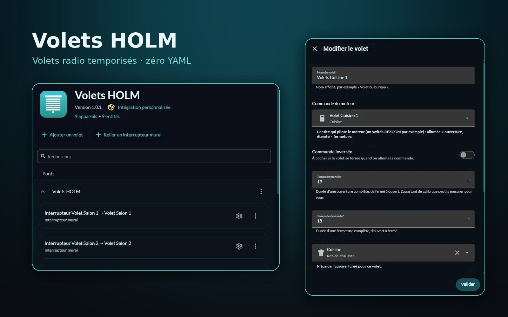
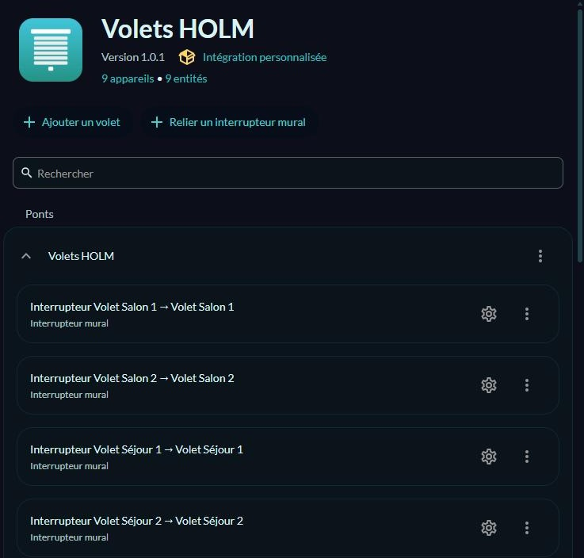
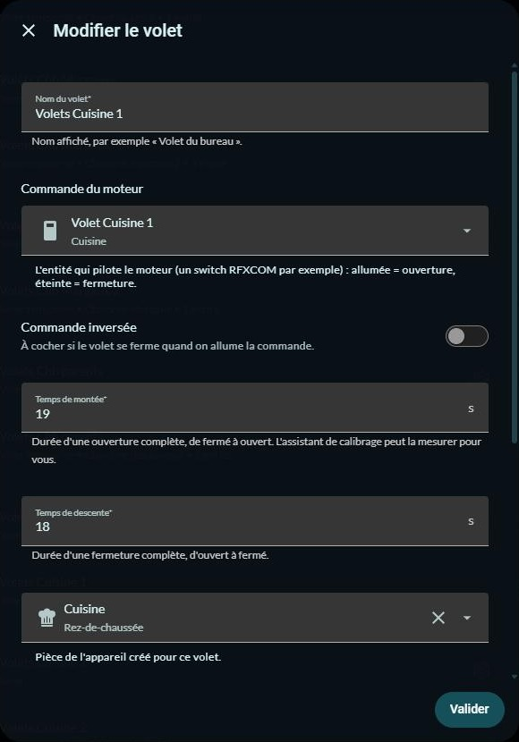

# 🪟 Volets HOLM

[🇫🇷 Français](README.md) · 🇬🇧 English

**Radio covers without position feedback (RFXCOM, DI-O, Chacon…) that know their position, and their wall switches, all set up from the UI.**

Many radio covers never tell where they are: you send them “up” or “down”, and that's it. Volets HOLM (“volets” means shutters in French) computes the position from the **travel time**, handles **stopping** (including modules that stop when the same command is sent again), **wall switches** and **remotes**, and is set up entirely in **Settings → Devices & services**.

> ✨ **Zero YAML, zero scripts.** No more three scripts and an `input_text` per cover: pick the switch that drives the motor, enter the opening and closing times (or have them measured), and you're done.

### At a glance

- 🎚️ **Computed position**: open, close, go to 40 %, stop. The position updates while moving and is **remembered** across restarts.
- 🛑 **Stopping done right**: for RF modules, stopping means resending the last command; Volets HOLM handles it and **never** resends an order in the direction the cover is already moving (which would stop it by mistake). A dedicated stop script or button is possible too.
- 🎯 **End-stop re-sync**: a few extra seconds when travelling to an end-stop to absorb drift, and a full travel if the cover is already reported at the end-stop (handy when a previous radio command got lost). **Re-sync** action on demand.
- ⏱️ **Calibration wizard**: the UI closes the cover, then times the opening and closing; you simply confirm when it reaches the top, then the bottom.
- 🔘 **Wall switches and remotes**:
  - **relayed**: presses go through Home Assistant (press = open / close, or stop if the cover is already moving);
  - **paired with the motor**: the motor reacts by itself, Volets HOLM tracks the position without sending anything.
- 🔗 **Links for other covers**: an RF wall switch can also drive a Z-Wave, Zigbee… cover (press while moving = stop).
- ↔️ **Inverted control** for motors wired the other way round.
- 🔁 **One-click import from Cover Time Based**, keeping entity_ids, areas, voice aliases and labels.
- 🌍 **8 languages**: English, French, German, Spanish, Italian, Dutch, Portuguese and Polish.

*Screenshots in French — the integration follows the language of Home Assistant.*

### 🆕 What's new in 1.1.0

- 🌍 **8 languages**: the integration (setup, options, entities, actions) is translated into English, French, German, Spanish, Italian, Dutch, Portuguese and Polish, following the language of Home Assistant.
- 🇬🇧 English README.

---

## Contents

- [Installation](#installation)
- [Getting started](#getting-started)
- [Cover settings](#cover-settings)
- [Wall switches](#wall-switches)
- [Calibration](#calibration)
- [Importing a Cover Time Based setup](#importing-a-cover-time-based-setup)
- [Actions](#actions)
- [FAQ](#faq)

---

## Installation

### With HACS (recommended)

1. HACS → ⋮ menu → **Custom repositories**.
2. Add `https://github.com/kaaribou/volets-holm`, category **Integration**.
3. Search for **Volets HOLM** → **Download**, then restart Home Assistant.

### Manually

1. Copy `custom_components/volets_holm` to `config/custom_components/`.
2. Restart Home Assistant.

## Getting started

1. **Settings → Devices & services → Add integration → Volets HOLM.**
2. If Cover Time Based covers exist, the wizard lists them and offers to import them (see below). Otherwise, just confirm.
3. On the integration page: **Add a cover** for each cover, **Link a wall switch** for a cover managed by another integration.
4. To edit or calibrate a cover: the ⋮ next to the cover → **Reconfigure**.

Each cover becomes a **device** with its `cover` entity, usable everywhere: cards (for example [HOLM Covers Card](https://github.com/kaaribou/holm-covers-card)), groups, automations, voice assistants.

## Cover settings

| Setting | Role |
|---|---|
| **Name** | Name of the device and entity. |
| **Motor control** | The entity driving the motor: an RFXCOM `switch` for example (on = opening, off = closing). `light` and `input_boolean` are accepted too. |
| **Inverted control** | If the cover closes when the control is turned on. |
| **Opening / closing time** | Duration of a full travel, in seconds (to the half second). |
| **Area** | Area of the device. |
| **Wall switch or remote** | Optional: the switch's *event* entity (RFXCOM creates one per switch). |
| **Switch behaviour** | *Relayed by Home Assistant* or *Paired with the motor (tracking only)*. |

**Advanced settings** (collapsed section):

| Setting | Default | Role |
|---|---|---|
| How to stop the motor | Resend the last command | Or call a stop entity (script, button, switch), or nothing. |
| Send a stop at end of travel | Yes | Useful for modules that stay active after the end-stop. |
| End-stop re-sync time | 2 s | Added when going fully up or fully down. |
| Full re-sync when already at end-stop | Yes | A new “close” on a cover reported closed runs a full travel again. |

## Wall switches

- **Relayed**: the switch has its own radio address and the motor doesn't listen to it. Volets HOLM receives the press and drives the cover: *up* = open (or stop if already going up), *down* = close (or stop if already going down).
- **Paired with the motor**: the switch or remote drives the motor directly (same address as the control). Volets HOLM sends nothing, it just updates the position. A second press in the same direction is understood as a stop.
- **Link** (cover from another integration): same logic as “relayed”, towards any `cover` entity.

## Calibration

The cover's ⋮ → **Reconfigure** → **Calibrate travel times**. Stay near the cover:

1. the cover closes completely;
2. you confirm: it goes up and the timer starts;
3. you confirm as soon as it reaches the top;
4. you confirm: it goes down;
5. you confirm as soon as it reaches the bottom.

The measured times are offered (editable) before being saved.

## Importing a Cover Time Based setup

If you used [Cover Time Based](https://github.com/nagyrobi/home-assistant-custom-components-cover-rf-time-based) (`cover_rf_time_based`) with open / close / stop scripts, adding the integration offers to take everything over:

- the covers, their travel times and the switch driven by their scripts (inverted direction detected);
- the wall switches linked by automations (relayed or paired with the motor), and those driving other covers (links);
- the **entity_ids**, areas, voice aliases, labels and assistant exposure: your automations, groups and dashboards keep working;
- optionally, the replaced switch automations are **disabled** (not deleted).

Then remove the `cover: - platform: cover_rf_time_based` section (and related `input_text`) from `configuration.yaml`, and restart. An alert in **Repairs** reminds you as long as the old configuration is loaded. The scripts can be deleted once you're happy.

The **Volets HOLM: Analyse existing setup** action (`volets_holm.detect_legacy`) shows what would be imported, without changing anything.

## Actions

| Action | Role |
|---|---|
| `volets_holm.set_known_position` | Sets the real position (0 to 100) without sending anything to the motor. |
| `volets_holm.recalibrate` | Sends the cover to the nearest end-stop, with a full travel. |
| `volets_holm.detect_legacy` | Lists what can be imported from Cover Time Based. |

The standard `cover.open_cover`, `close_cover`, `set_cover_position` and `stop_cover` actions work as for any cover.

## FAQ

| Problem | Solution |
|---|---|
| The position drifts over the days | Run the calibration, or slightly increase the end-stop re-sync time. A trip to an end-stop re-syncs the position. |
| An “open” command stops the cover | The cover may already have been moving after an undeclared remote: declare it as a switch *paired with the motor*. |
| The cover goes the wrong way | Tick **Inverted control**. |
| The wall switch does nothing | Check that its *event* entity changes on each press (Developer tools → States). |

---

## Credits

- Position computation inspired by [Cover Time Based](https://github.com/nagyrobi/home-assistant-custom-components-cover-rf-time-based) and the TravelCalculator of [XKNX](https://github.com/XKNX/xknx); rewritten for this integration.

---

## Say thanks?

Like the integration? You can buy me a beer 🍺

---

## License

Code: **MIT** license — © kaaribou. See the [CHANGELOG](CHANGELOG.md) (in French).

Part of **HOLM — Home Orchestration & Living Management**: smart management and orchestration of the home.

Other projects: [Carburant HOLM](https://github.com/kaaribou/carburant-holm) · [Climat HOLM](https://github.com/kaaribou/climat-holm) · [HOLM HP/HC](https://github.com/kaaribou/holm-tarif) · [HOLM Lektrico](https://github.com/kaaribou/lektrico-holm) · [HOLM LaMetric](https://github.com/kaaribou/lametric-holm) · [HOLM My Menu](https://github.com/kaaribou/holm-mymenu) · [HOLM Cars](https://github.com/kaaribou/holm-cars) · [HOLM GitHub](https://github.com/kaaribou/github-holm) · [HOLM Navbar Card](https://github.com/kaaribou/holm-navbar-card) · [HOLM Climate Card](https://github.com/kaaribou/climate-card-holm) · [HOLM Music Card](https://github.com/kaaribou/holm-music-card) · [HOLM Energy Cards](https://github.com/kaaribou/holm-energy-cards) · [HOLM Power Flow Card](https://github.com/kaaribou/holm-power-flow-card) · [HOLM Ecojoko Card](https://github.com/kaaribou/holm-ecojoko-card) · [HOLM Runtime Card](https://github.com/kaaribou/holm-runtime-card) · [HOLM Covers Card](https://github.com/kaaribou/holm-covers-card) · [HOLM Floor Card](https://github.com/kaaribou/holm-floor-card) · [HOLM Radiator Card](https://github.com/kaaribou/holm-radiator-card) · [HOLM Security Card](https://github.com/kaaribou/holm-security-card) · [HOLM Sentinel Card](https://github.com/kaaribou/holm-sentinel-card) · [HOLM Recordings Card](https://github.com/kaaribou/holm-recordings-card) · [HOLM Smoke Card](https://github.com/kaaribou/holm-smoke-card) · [HOLM Family Card](https://github.com/kaaribou/holm-family-card) · [HOLM Govee Light Card](https://github.com/kaaribou/holm-govee-light-card) · [HOLM Leapmotor Card](https://github.com/kaaribou/holm-leapmotor-card).
