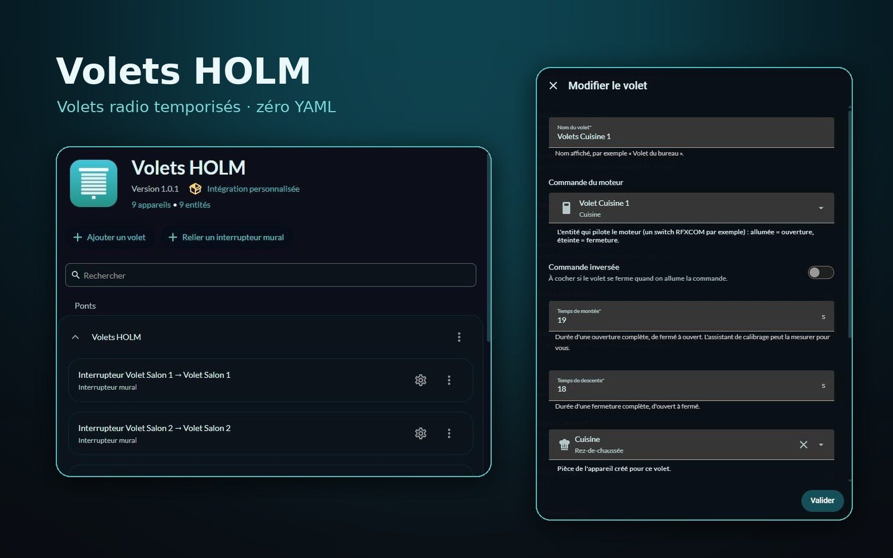
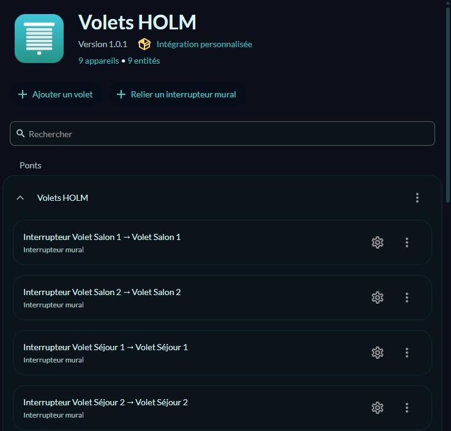
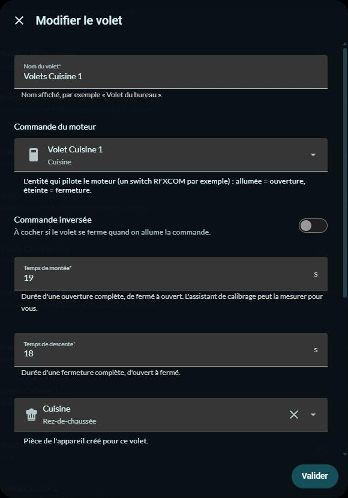

# 🪟 Volets HOLM

**Des volets radio sans retour d'état (RFXCOM, DI-O, Chacon…) qui connaissent leur position, et leurs interrupteurs muraux, le tout réglé depuis l'interface.**

Beaucoup de volets radio ne disent jamais où ils en sont : on leur envoie « monte » ou « descends », et c'est tout. Volets HOLM calcule la position d'après le **temps de course**, gère l'**arrêt** (y compris pour les modules qui s'arrêtent quand on renvoie la même commande), les **interrupteurs muraux** et les **télécommandes**, et se configure entièrement dans **Paramètres → Appareils et services**.

> ✨ **Zéro YAML, zéro script.** Fini les trois scripts et l'`input_text` par volet : on choisit le switch qui commande le moteur, on indique les temps de montée et de descente (ou on les fait mesurer), et c'est prêt.

### En bref

- 🎚️ **Position calculée** : ouvrir, fermer, aller à 40 %, stop. La position est mise à jour pendant le mouvement et **mémorisée** au redémarrage.
- 🛑 **Arrêt comme il faut** : pour les modules RF, l'arrêt consiste à renvoyer la dernière commande ; Volets HOLM s'en charge et ne renvoie **jamais** un ordre dans le sens où le volet bouge déjà (ce qui l'arrêterait par erreur). Un script ou un bouton d'arrêt dédié est aussi possible.
- 🎯 **Recalage aux extrémités** : quelques secondes de plus quand on va en butée pour rattraper la dérive, et une course complète si le volet est déjà annoncé en butée (pratique quand un ordre radio précédent s'est perdu). Action **Recaler** à la demande.
- ⏱️ **Assistant de calibrage** : l'interface ferme le volet, puis chronomètre la montée et la descente ; vous validez simplement quand il arrive en haut, puis en bas.
- 🔘 **Interrupteurs muraux et télécommandes** :
  - **relayés** : l'appui passe par Home Assistant (appui = ouvrir / fermer, ou stop si le volet bouge déjà) ;
  - **appairés au moteur** : le moteur réagit seul, Volets HOLM suit la position sans rien renvoyer.
- 🔗 **Liaisons pour les autres volets** : un interrupteur mural RF peut aussi piloter un volet Z-Wave, Zigbee… (appui pendant le mouvement = stop).
- ↔️ **Commande inversée** pour les moteurs câblés à l'envers.
- 🔁 **Reprise de Cover Time Based** en un clic, en gardant les entity_id, pièces, alias vocaux et labels.

---

## Sommaire

- [Installation](#installation)
- [Premiers pas](#premiers-pas)
- [Réglages d'un volet](#réglages-dun-volet)
- [Interrupteurs muraux](#interrupteurs-muraux)
- [Calibrage](#calibrage)
- [Reprendre une installation Cover Time Based](#reprendre-une-installation-cover-time-based)
- [Actions](#actions)
- [Questions fréquentes](#questions-fréquentes)

---

## Installation

### Avec HACS (recommandé)

1. HACS → menu ⋮ → **Dépôts personnalisés**.
2. Ajoutez `https://github.com/kaaribou/volets-holm`, catégorie **Intégration**.
3. Recherchez **Volets HOLM** → **Télécharger**, puis redémarrez Home Assistant.

### Manuellement

1. Copiez `custom_components/volets_holm` dans `config/custom_components/`.
2. Redémarrez Home Assistant.

## Premiers pas

1. **Paramètres → Appareils et services → Ajouter une intégration → Volets HOLM.**
2. Si des volets Cover Time Based existent, l'assistant les liste et propose de les reprendre (voir plus bas). Sinon, validez simplement.
3. Sur la carte de l'intégration : **Ajouter un volet** pour chaque volet, **Relier un interrupteur mural** pour un volet géré par une autre intégration.
4. Pour modifier ou calibrer un volet : les ⋮ en face du volet → **Reconfigurer**.

Chaque volet devient un **appareil** avec son entité `cover`, utilisable partout : cartes (par exemple [HOLM Covers Card](https://github.com/kaaribou/holm-covers-card)), groupes, automatisations, assistants vocaux.

## Réglages d'un volet

| Réglage | Rôle |
|---|---|
| **Nom** | Nom de l'appareil et de l'entité. |
| **Commande du moteur** | L'entité qui pilote le moteur : un `switch` RFXCOM par exemple (allumé = ouverture, éteint = fermeture). `light` et `input_boolean` sont aussi acceptés. |
| **Commande inversée** | Si le volet se ferme quand on allume la commande. |
| **Temps de montée / de descente** | Durée d'une course complète, en secondes (au demi-seconde près). |
| **Pièce** | Pièce de l'appareil. |
| **Interrupteur mural ou télécommande** | Facultatif : l'entité *évènement* de l'interrupteur (RFXCOM en crée une par interrupteur). |
| **Fonctionnement de l'interrupteur** | *Relayé par Home Assistant* ou *Appairé au moteur (suivi seulement)*. |

**Réglages avancés** (section repliée) :

| Réglage | Par défaut | Rôle |
|---|---|---|
| Comment arrêter le moteur | Renvoyer la dernière commande | Ou appeler une entité d'arrêt (script, bouton, interrupteur), ou rien. |
| Envoyer un arrêt en fin de course | Oui | Utile pour les modules qui restent actifs après la butée. |
| Temps de recalage aux extrémités | 2 s | Ajouté quand on va tout en haut ou tout en bas. |
| Recalage complet si déjà en butée | Oui | Un nouvel ordre « fermer » sur un volet annoncé fermé relance une course complète. |

## Interrupteurs muraux

- **Relayé** : l'interrupteur a sa propre adresse radio et le moteur ne l'écoute pas. Volets HOLM reçoit l'appui et commande le volet : *haut* = ouvrir (ou stop s'il monte déjà), *bas* = fermer (ou stop s'il descend déjà).
- **Appairé au moteur** : l'interrupteur ou la télécommande commande directement le moteur (même adresse que la commande). Volets HOLM ne renvoie rien, il met simplement la position à jour. Un second appui dans le même sens est compris comme un arrêt.
- **Liaison** (volet d'une autre intégration) : même logique que « relayé », vers n'importe quelle entité `cover`.

## Calibrage

⋮ du volet → **Reconfigurer** → **Calibrer les temps de course**. Restez près du volet :

1. le volet se ferme entièrement ;
2. vous validez : il monte et le chronomètre démarre ;
3. vous validez dès qu'il arrive en haut ;
4. vous validez : il descend ;
5. vous validez dès qu'il arrive en bas.

Les temps mesurés sont proposés (modifiables) avant d'être enregistrés.

## Reprendre une installation Cover Time Based

Si vous utilisiez [Cover Time Based](https://github.com/nagyrobi/home-assistant-custom-components-cover-rf-time-based) (`cover_rf_time_based`) avec des scripts d'ouverture / fermeture / arrêt, l'ajout de l'intégration propose de tout reprendre :

- les volets, leurs temps de course et le switch commandé par leurs scripts (sens inversé détecté) ;
- les interrupteurs muraux reliés par des automatisations (relayés ou appairés au moteur), et ceux qui pilotent d'autres volets (liaisons) ;
- les **entity_id**, pièces, alias vocaux, labels et exposition aux assistants : vos automatisations, groupes et tableaux de bord continuent de fonctionner ;
- en option, les automatisations d'interrupteurs remplacées sont **désactivées** (pas supprimées).

Ensuite, retirez la section `cover: - platform: cover_rf_time_based` (et les `input_text` associés) de `configuration.yaml`, puis redémarrez. Une alerte dans **Réparations** vous le rappelle tant que l'ancienne configuration est chargée. Les scripts peuvent être supprimés quand vous êtes satisfait.

L'action **Volets HOLM : Analyser l'existant** (`volets_holm.detect_legacy`) montre ce qui serait repris, sans rien modifier.

## Actions

| Action | Rôle |
|---|---|
| `volets_holm.set_known_position` | Indique la position réelle (0 à 100) sans rien envoyer au moteur. |
| `volets_holm.recalibrate` | Envoie le volet en butée du côté le plus proche, avec une course complète. |
| `volets_holm.detect_legacy` | Liste ce qui peut être repris depuis Cover Time Based. |

Les actions standard `cover.open_cover`, `close_cover`, `set_cover_position` et `stop_cover` fonctionnent comme pour n'importe quel volet.

## Questions fréquentes

| Problème | Solution |
|---|---|
| La position dérive au fil des jours | Lancez le calibrage, ou augmentez un peu le temps de recalage aux extrémités. Un aller en butée recale la position. |
| Un ordre « ouvrir » arrête le volet | Le volet bougeait peut-être déjà suite à une télécommande non déclarée : déclarez-la comme interrupteur *appairé au moteur*. |
| Le volet va dans le mauvais sens | Cochez **Commande inversée**. |
| L'interrupteur mural ne fait rien | Vérifiez que son entité *évènement* change bien à chaque appui (Outils de développement → États). |

---

## Un petit merci ?

L'intégration vous plaît ? Vous pouvez m'offrir une bière 🍺

---

## Crédits & licence

- Code : licence **MIT** — © kaaribou. Voir le [CHANGELOG](CHANGELOG.md).
- Calcul de position inspiré de [Cover Time Based](https://github.com/nagyrobi/home-assistant-custom-components-cover-rf-time-based) et du TravelCalculator de [XKNX](https://github.com/XKNX/xknx) ; réécrit pour cette intégration.

Fait partie de **HOLM — Home Orchestration & Living Management** : la gestion et l'orchestration intelligente de la maison.

Les autres projets : [Climat HOLM](https://github.com/kaaribou/climat-holm) · [Carburant HOLM](https://github.com/kaaribou/carburant-holm) · [Commandes à la maison HOLM](https://github.com/kaaribou/commandes-holm) · [HOLM LaMetric](https://github.com/kaaribou/lametric-holm) · [HOLM My Menu](https://github.com/kaaribou/holm-mymenu) · [HOLM Lektrico](https://github.com/kaaribou/lektrico-holm) · [HOLM Covers Card](https://github.com/kaaribou/holm-covers-card) · [HOLM Navbar Card](https://github.com/kaaribou/holm-navbar-card) · [HOLM Climate Card](https://github.com/kaaribou/climate-card-holm) · [HOLM Music Card](https://github.com/kaaribou/holm-music-card) · [HOLM Sentinel Card](https://github.com/kaaribou/holm-sentinel-card) · [HOLM Security Card](https://github.com/kaaribou/holm-security-card) · [HOLM Recordings Card](https://github.com/kaaribou/holm-recordings-card) · [HOLM Power Flow Card](https://github.com/kaaribou/holm-power-flow-card) · [HOLM Energy Cards](https://github.com/kaaribou/holm-energy-cards) · [HOLM Radiator Card](https://github.com/kaaribou/holm-radiator-card) · [HOLM Floor Card](https://github.com/kaaribou/holm-floor-card) · [HOLM Ecojoko Card](https://github.com/kaaribou/holm-ecojoko-card) · [HOLM Smoke Card](https://github.com/kaaribou/holm-smoke-card) · [HOLM BG Card](https://github.com/kaaribou/holm-bg-card).

Article de présentation : [homelive.fr](https://homelive.fr/volets-holm-vos-volets-radio-savent-enfin-ou-ils-en-sont/)
